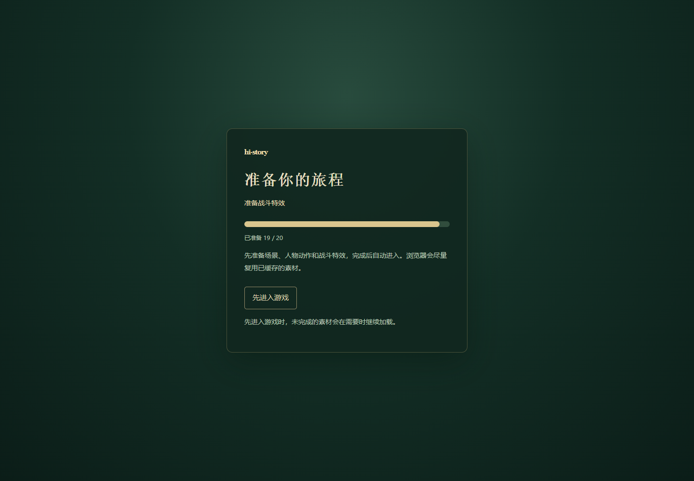
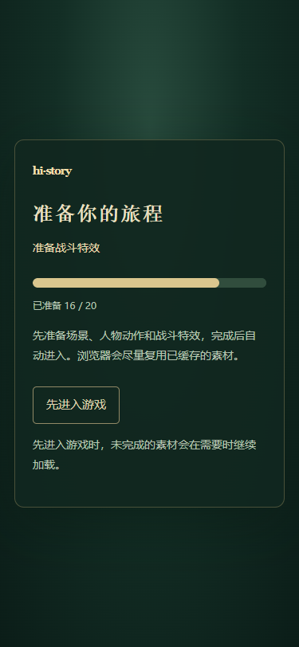

# 开局素材准备验证

后续已按用户要求发布至`gh-pages@c2a831e`，实际部署与公网验收见 [发布记录](asset-preload-publication.md)。下文保留开发候选阶段的测试范围、首次失败和缓存限制。

2026-11-17，分支 `codex/adventure-asset-preload`，基于PixelFX接入提交 `0314f5e`。用户希望先下载一部分素材再开始游戏。本轮为候选源码，未部署线上；产品0.6.0/schema5/save1及既有素材协议不变。

## 实际行为

初次进入、新旅程、继续/导入存档产生新runId时，先展示“准备你的旅程”。完成后自动进入；加载期间没有可操作场景，方向键和命令入口被阻止。准备项由本局快照决定，不提前探索地图、计算新规则或改动存档。成功后立即绘制首个场景/人物/战斗画面，不靠计时器延迟解锁。

优先范围：

- 五张场景图集，成功缓存和请求去重，预加载后WorldScene直接复用。
- 当前玩家的00站立、01行走、03跑步、05攻击、06施法、08受伤、09防御、10倒下、16交谈。
- 当前可见非参战NPC的00/01/10/16；进行中战斗的NPC参战者为00/01/03/05/06/08/09/10，即使其探索位置暂不可见。怪物仍使用自己的模型身份。
- 已接入的六类PixelFX特效，预先解码；进入实际战斗时复用成功缓存。

同一人物模型和动作图集去重，不下载整个28人目录。进度是实际完成的准备项：场景图集组一项，每个人物动作图集一项，每类特效一项；不是下载字节百分比。目录读取阶段保持不定进度，失败项不计为已完成，缓存命中检查后计为已准备。

准备整体30秒上限，人物/场景请求各15秒含排队。失败后可“重试加载”；加载期间或失败后也可“先进入游戏”，取消本次准备并允许已有按需加载继续。迟到结果不能覆盖重试、新局或退出后的界面；失败、取消、重试都不会重新生成旅程或再次结算。

## 缓存和范围

人物压缩Blob缓存为16MiB/96张，单张2MiB；解码缓存仍为24张/1200万像素。首屏站姿/倒地与头像优先解码，剩余预算用于玩家常用动作；已预取但未驻留的动作按需解码。准备任务最多3并发，人物下载和解码各最多3并发，世界图集最多2并发。共享请求最后一个等待者退出后取消实际IO并释放队列名额，单个等待者取消不影响其他消费者。

默认玩家九动作实测398,226字节；全名册每人的同组九动作为342,688–694,826字节。NPC站/走/倒下三动作约129,928–245,314字节，实际计划还可能包含交谈或战斗动作。PixelFX六图集共2,933,770字节/解码约48.8MiB。没有全页面内存/低端移动硬件的性能预算证明，不将缓存上限等同于总内存占用。

缓存驻留当前页面，刷新由正常浏览器HTTP缓存决定是否重新请求；没有service worker、持久离线缓存或离线可玩承诺。远处未参与首屏的角色、后来唤醒的魔物、人物馆其他动作继续按需加载。主动跳过时允许出现既有占位提示，不能把降级入口宣称为全部素材就绪。

## 已完成验证

- 新增加载器10项测试与原人物16项，共26项通过，覆盖请求去重、独立取消、队列释放、缓存界限、失败/超时重试、成功世界图集复用。
- 加入计划范围/动作去重/预算/不改状态等5项测试后，42项受影响逻辑聚焦检查通过。
- 全量459项逻辑测试通过，0失败、0跳过；[机器报告](evidence/preload-logic-results.json)。以上26/42均已包含在459中，不重复累计。
- 新启动浏览器12项（桌面6、375px窄屏6）首次批次通过：冷启动等待及首帧、失败重试、明确跳过、超时取消重试、同页重开缓存、旧战斗存档准备后实际施法和刷新恢复；[机器报告](evidence/preload-browser-results.json)。
- 原有特效34项浏览器回归通过（桌面17、375px17），覆盖六类真实结果、损坏/失败/超时、后台取消、换局和刷新不重播；[机器报告](evidence/preload-effects-regression-results.json)。
- 人物馆、换外形、玩法闭环与慢设备交互合并批次28项中，首次26通过、2失败；失败均为人物馆错误提示措辞改变，修正后完整人物馆12项（桌面6、375px6）通过。分别保留[首次报告](evidence/preload-regression-browser-results.json)和[修正复验](evidence/preload-library-retry-results.json)，未覆盖首次失败记录。
- 上述合计74项不同浏览器用例分批通过（12+34+28，人物馆复验不重复累计），不是一次全量全绿。玩法闭环12项覆盖实际靠近、材料补货、先行动后接取、任务分叉、失败补救、截止时间拒绝和刷新不重领。
- `test:closure` 18项逻辑另行通过，[报告](evidence/preload-closure-logic-results.json)；包含在459中。最后错误提示修正后42项受影响逻辑复验通过，[报告](evidence/preload-final-focused-results.json)。类型、模块边界及生产构建最终通过。

4倍CPU减速、真实时钟的原场景响应检查在桌面与375px通过：空闲每帧平均24次场景图像绘制，最大50ms心跳间隔分别58.3ms/63.3ms；菜单实测594ms/559ms。实际移动、松键停止、保存和刷新均通过，无页面错误。测量作为该机器的回归证据，不代表真实低端手机的帧率或全页面内存证明；原始数值保存在首次回归报告的responsiveness附件。

## 过程与边界

- 原特效故障测试在进入游戏后才拦截请求。新增预热使这些资源已经成功缓存，因此改为在冷刷新前安装故障路由、通过真实“先进入游戏”进入降级，再实际施法；仍检查失败/超时/取消后骰子、操作和已提交状态。
- 首个特效回归批次通过9项后主动中断以补齐故障恢复的测试辅助流程：故障路由持续存在时，刷新后的准备页需要再次明确跳过；没有将这次未完成批次算作完整通过，也未改产品来迎合旧测试。
- 人物馆首次失败期望“加载失败”，共享加载器实际提示“素材图像读取失败，请重试”；错误状态及禁用按钮已正常显示。将提示统一为“素材图像加载失败，请重试”，保留原浏览器断言，再通过真实503后重新加载验证；未删减失败或重试检查。
- 原慢设备用例截图路径从`/tmp`改为Playwright的`info.outputPath`，使Windows运行产物留在工作区；性能阈值和操作步骤保持。
- 浏览器使用系统Chrome无头模式，仅本地生产构建；启动和图片解码异步完成，首屏成功不依赖推进假时钟。超时和特效取消使用针对性时钟/事件模拟，不能替代真实断网或操作系统后台测试。
- 尚未更新公网，不把本地验收描述为线上已生效。

## 复验

```powershell
npm test -- --maxWorkers=2 --reporter=json --outputFile=docs/evidence/preload-logic-results.json
npm run test:closure -- --reporter=json --outputFile=docs/evidence/preload-closure-logic-results.json
npx vitest run tests/asset-loaders.test.ts tests/adventure-assets.test.ts tests/external-character-models.test.ts tests/combat-effect-assets.test.ts --maxWorkers=2 --reporter=json --outputFile=docs/evidence/preload-final-focused-results.json
npm run typecheck
npm run check:boundaries
npm run build
$env:CHROMIUM_PATH='C:/Program Files/Google/Chrome/Application/chrome.exe'
$env:PLAYWRIGHT_REPORT_PATH='docs/evidence/preload-browser-results.json'
npm run test:e2e -- tests/e2e/asset-preload.spec.ts
$env:PLAYWRIGHT_REPORT_PATH='docs/evidence/preload-effects-regression-results.json'
npm run test:e2e -- tests/e2e/monster-effects.spec.ts tests/e2e/pixelfx-effects.spec.ts
$env:PLAYWRIGHT_REPORT_PATH='docs/evidence/preload-regression-browser-results.json'
npm run test:e2e:closure -- tests/e2e/character-library.spec.ts tests/e2e/external-character-game.spec.ts tests/e2e/scene-responsiveness.spec.ts
$env:PLAYWRIGHT_REPORT_PATH='docs/evidence/preload-library-retry-results.json'
npm run test:e2e -- tests/e2e/character-library.spec.ts
```

## 视觉证据

已查看两个尺寸准备页，进度与操作按钮无横向溢出：




