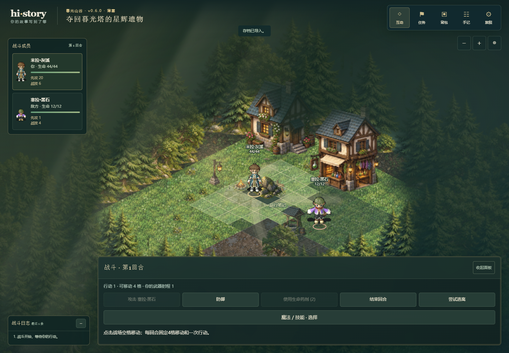
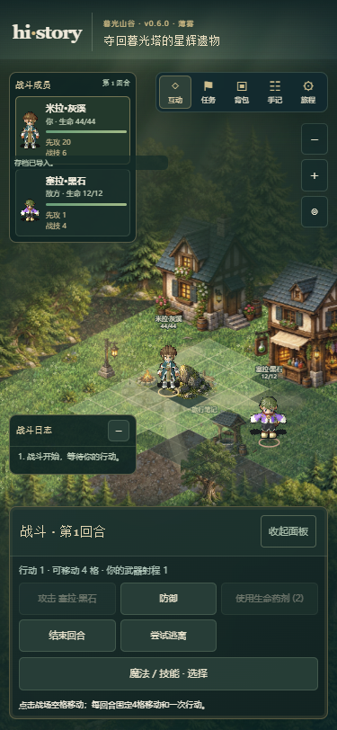
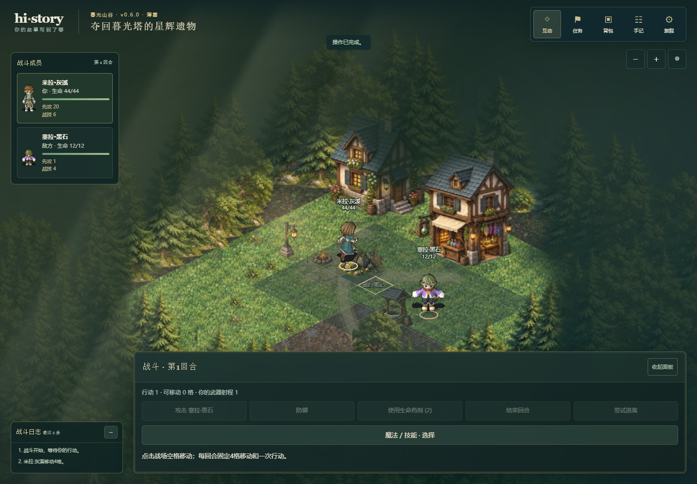

# 战斗跑步与界面布局验证

日期：2026-10-18。分支 `codex/battle-running-layout`，基于已推送 `codex/combat-skill-choices@4334160`。产品/快照0.6.0、demo-contract/5、schema5、save1与world-v2保存槽保持。线上仍为v0.5.0；本轮交付候选源码，不部署网站。提交号以同报告提交的Git历史为准。

## 已实现范围

- 玩家点选合法格后沿运行器BFS实际路线逐格跑步，保留原碰撞、步数和一次提交；绕障碍不穿越阻挡。
- 活动战斗结束回合后，NPC沿原决策的实际路径依次跑步接近；不改变敌人AI、先攻、攻击或随机流。
- 复用现有外部人物03跑步八方向，普通150ms/格；减少动态效果85ms/格且保持原静帧偏好。人物、姓名、脚下圈与命中组整体移动，镜头持续跟随显示中的玩家中心。
- 左侧成员栏显示同模型头像、生命条、先攻、职业资源与防御；底部为普通行动与魔法/技能选择，仍按能力→合法目标→确认使用。
- 左下独立战斗日志显示最近40条，移动、攻击、施法沿用权威日志。日志与行动面板各自可收起；浏览旧日志时重绘保留阅读位置。
- 跑步期间禁止重复行动；完成路线后播放同次已提交的骰子与攻击视觉。刷新直接恢复已提交终点，不重播、额外扣移动或重掷骰子。

## 模块与兼容

运行器公开 `combatRoute`、`tacticalActionWithMovement` 与 `COMBAT_MOVEMENT_VERSION='combat-movement/1'`。返回 `{runtime,movement:{version,encounterId,moves:[{actorId,path}]}}`，每条path含起终点。旧 `tacticalAction` 保留runtime返回，通行代价来自同一BFS。NPC只收集原决策实际经过的坐标，移动日志不引入随机调用。

应用 `dispatch` 只在完整提交后返回可选深冻结 `combatMovement`；失败、重复命令、保存和恢复没有此证据。公开 `BattleMovementPlayback` 仅校验并插值同局同遭遇的连续路线与终点，不发命令、不写快照、不使用RNG。换局、页面隐藏或卸载可取消表现。`AdventureMotion.replayCommittedChanges` 只重启已提交攻击视觉，避开跑步期间动作过期和事件去重，不重新结算。

左侧资源和日志立即反映已提交结果，因此本轮不是逐攻击/逐伤害延迟揭晓的事件时间线。开战时没有旧战场、以及结算后已经结束的遭遇，不播放路线过场。没有导入新怪物、武器外观或独立元素特效。怪物图鉴已有施法动作按用户纠正保留为后续素材来源，不能报告已接入。

## 实际检查

Windows、Node24.16.0、本机Chrome；Playwright使用单worker，桌面1440×1000及375×812。

| 检查 | 结果与证据 |
| --- | --- |
| 完整逻辑 | 26文件392/392通过，约236.6秒；[原始结果](evidence/battle-layout-logic.json) |
| 类型 | `npm.cmd run typecheck`通过 |
| 模块边界 | `npm.cmd run check:boundaries`通过 |
| 生产构建 | `npm.cmd run build`通过，128模块 |
| 新战斗界面与跑步 | 10/10通过，桌面/窄屏各5项 |
| 技能、装备、镜头与性能回归 | 22/22通过，桌面/窄屏各11项 |

新增8项逻辑覆盖实际绕障路线与代价、非法目标不变、NPC逐步路径、提交/回滚/去重/冻结/保存边界、连续插值与结束位置、NPC串行播放与减少动态效果、换局/不连续证据拒绝、移动后攻击视觉重启且不改快照。

新增10项浏览器检查以校验封套的战斗存档经真实导入入口启动，正常点击可达格、行动与技能按钮，使用暂停浏览器时钟检查中途坐标、03动作、按钮锁定、镜头中心和单次提交；同时检查元素法术资源/日志、刷新恢复及移动中刷新。回归包含从建角真实行走进入战斗、装备购买穿脱和导入旧版存档、退出战斗回探索、镜头拖动/缩放/屏幕变化以及慢设备交互。

首轮新浏览器用例为6通过/4失败，失败停在暂停时钟下的骰子反馈：原测试等待器未持续推进并操作“跳过动画／继续冒险”。修正为正常推进与按钮操作，未绕过输入锁或force点击。视觉复核同时发现全站窄屏aside两列规则挤压成员卡，新增战斗栏display:block与卡片宽度断言。截图在重绘后等待真实人物帧加载；首轮原始结果与截图保留本地忽略目录 `_handoff/audit/battle-layout-first*`。不把首轮失败报告算作全部通过，也不将前轮技能验收数量加为本轮测试。

最终浏览器一次32/32通过（零跳过、零失败、零重试），393.4秒，开始于2026-10-18 22:22:20（北京时间）。原始输出 [battle-layout-browser.json](evidence/battle-layout-browser.json)。本次逻辑和浏览器为不同检查命令，不代表执行了仓库全部历史浏览器用例。

## 视觉证据

已实际打开核对以下最终截图，包含手机单列成员卡与跑步中间帧。它们来自本地生产预览，不是线上截图。







## 复验命令

```powershell
npm.cmd run typecheck
npm.cmd run check:boundaries
npm.cmd test -- --reporter=json --outputFile=docs/evidence/battle-layout-logic.json
npm.cmd run build
$env:CHROMIUM_PATH='C:\Program Files\Google\Chrome\Application\chrome.exe'
$env:PLAYWRIGHT_REPORT_PATH='docs/evidence/battle-layout-browser.json'
npm.cmd run test:e2e -- tests/e2e/battle-layout.spec.ts tests/e2e/combat-skills.spec.ts tests/e2e/equipment-gameplay.spec.ts tests/e2e/player-camera.spec.ts tests/e2e/scene-responsiveness.spec.ts
```

源码上传不等于网站发布。后续发布仍需要独立记录构建、公网资源和真实浏览器复验；本轮没有更新gh-pages。
