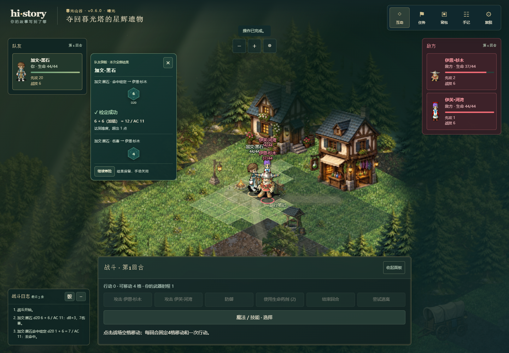
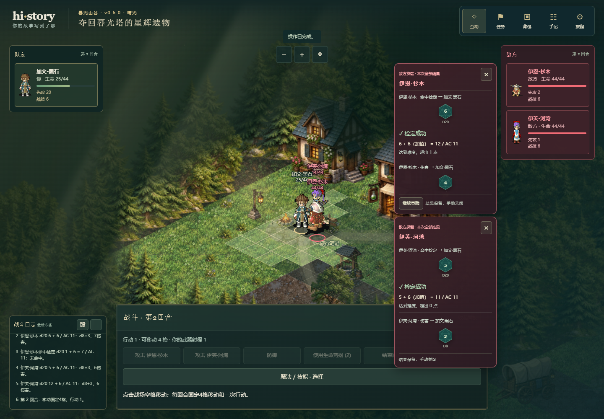
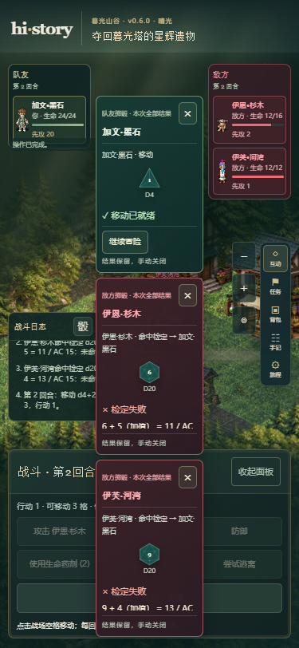

# 双侧战斗状态与小骰子面板验证

日期：2026-10-18。分支 `codex/battle-side-dice`，继承已推送725d78e。产品/快照0.6.0、schema5/demo-contract/5、save1与world-v2保存槽保持；仅骰子反馈DTO升级为dice-feedback/3。线上仍v0.5.0，本轮没有部署。提交号以同报告提交的Git历史为准。

## 用户可见变化

- 战斗队友在左，敌人在右。敌方状态卡、生命条、战场姓名与脚下圈标红；名字、模型、生命与资源仍来自同一快照。
- 骰子在实际掷骰者栏旁播放：队友栏右侧、敌人栏左侧。雷法的目标豁免骰归敌人，伤害骰归施法者；不按命令发起者或姓名统一定位。
- 没有全屏模糊背景、遮罩、场景inert或Tab约束。可阅读/收起战斗日志和查看只读界面；既有busy仍阻止重复结算命令。
- 按原顺序翻滚、落定、揭晓；本次全部结果分角色留存，等待手动×或“继续冒险”关闭，不再2.2秒后自动消失。×可在动画期间关闭本批；跳过直接展示结果，回看与减少动态效果也手动关闭。
- 375px两侧状态栏保留，中间窄通道的结果面板上下错开、各自滚动；总览友方优先显示，不改变实际掷骰顺序。战斗日志标题“骰”按钮提供回看。
- 战斗刚结束时暂留已提交双方只读状态栏，最后一击的骰子仍能归栏；关闭后移除。战后回看同样临时显示双方状态，关闭回到原画面。

当前规则只有玩家一名友方；未新增伙伴参战、阵营、行动或技能规则。角色上限仍玩家加最多两名敌人，外观与素材不改。

## 数据与边界

DiceFeedback新增actorId、side:'ally'|'enemy'与targetId?，直接从运行器已有骰子记录投影；探索CheckResult归玩家。dice-feedback/3是只读展示契约，不加入Snapshot.versions或保存字段。所有骰面、骰值、加值、阈值和结论仍来自原运行器；同名演员用稳定身份区分。

小面板按当前DOM成员框计算位置，缩放/重绘可重新挂接；多个结果不重叠或越出屏幕。页脚、关闭与跳过均不执行命令；内部显示状态和战后临时栏不写存档。成功提交后才播放，失败/重复命令没有新批次；刷新不重播，恢复/换局/销毁取消旧等待与计时器。原移动→法术特效→骰子顺序、资源与RNG保持。

## 实际验证

Windows、Node24.16.0、Chrome，Playwright单worker；桌面1440×1000，窄屏375×812。

| 检查 | 结果 |
| --- | --- |
| 完整逻辑 | 29文件408/408通过，约226.0秒；[原始结果](evidence/battle-side-dice-logic.json) |
| 类型/边界 | typecheck、check:boundaries通过 |
| 构建 | build通过，133模块；最终焦点/回看修正后已复建通过 |
| 首轮新浏览器用例 | 14/14通过，桌面/375px各7项；原始结果保留 `_handoff/audit/battle-side-dice-first.json` |
| 综合浏览器回归 | 首批70项：68通过/2焦点失败，648.5秒，开始于2026-10-18 23:30:41（北京时间）；原始输出 [battle-side-dice-browser.json](evidence/battle-side-dice-browser.json) |
| 焦点/战后回看专项 | 4项中3通过/1窄屏Tab预期失败；战后回看两种尺寸均通过，[原始结果](evidence/battle-side-dice-repair-browser.json) |
| 触摸焦点与最终Tab复验 | 明确跳过后的聚焦，过渡批次1通过/1窄屏Tab预期失败，[原始结果](evidence/battle-side-dice-focus-browser.json)；允许键盘进入可滚动公式区后，桌面/窄屏2/2通过，28.3秒，[最终结果](evidence/battle-side-dice-final-focus-browser.json) |

合计70项不同浏览器用例分批验证通过。68/70的综合批次保留失败记录，不能称为一次70项全绿；修正后的战后回看和键盘检查分别有独立证据，未重复跑全部无关检查。

新增4项逻辑检查稳定身份/阵营/目标、雷法豁免与伤害的相反归属、同名人物及换局/重复读取。原骰子随机序列、公式/重击/优势/劣势、资源、装备、保存、回滚等全量逻辑仍通过。

新增14项浏览器检查覆盖：左右两栏及红色敌人；队友/敌人骰子分别定位；等待20—30秒不自动关闭；动画期间日志可读、场景无inert/遮罩；雷法由敌人掷豁免；三名掷骰者结果不重叠/越界；本批关闭与回看不改快照；动画中刷新不重播；战斗结束和战后回看保留只读双方状态，关闭后移除。场景采用校验封套经真实导入入口进入，用正常点击与暂停浏览器时钟检查，没有force点击或新增规则状态。

综合批次还覆盖原骰子成功/失败/优势/偏好/声音/减少动态效果/刷新/先攻移动，以及战斗跑步、技能目标、怪物/特效、镜头与慢设备。

## 本轮修正与实际限制

首轮新14项全部通过。视觉核对发现全站footer样式带入底部40px空白，已明确重置小面板页脚padding；截图在重绘后等待全部真实人物帧。手机总览优先友方，避免友方结果被排到中间通道底部。

综合批次发现桌面/窄屏各一项键盘焦点失败：点“跳过动画”后原按钮被结果总览替换，不能继续聚焦不存在的skip按钮。修正为回退到当前关闭按钮，触摸跳过时也明确聚焦结果；同时给战后回看补上临时只读阵营栏。随后桌面和两种尺寸战后回看通过，但窄屏原测试要求一次Tab直接到“继续冒险”，忽略了Chrome可聚焦的滚动公式区。最终检查允许先进入该区，再到继续按钮，并断言下一次Tab可离开面板；两种尺寸均通过。未恢复Tab陷阱或绕过真实键盘操作。综合与过渡失败输出均保留，修正后的用例单独复验，不将多批结果说成一次全绿。

这是已提交结果的展示。反馈期间仍需关闭结果后再行动，HP/日志不是逐骰延迟结算。极窄屏上的长公式与后果需要在小面板内部滚动；没有增加伙伴规则、全屏物理骰子、存档中的动画队列或自动线上发布。

## 已核对截图

已实际打开查看最终桌面队友/敌人面板和375px三人总览。为本地生产预览截图；综合批次使用了页脚留白和显示排序修正，最终焦点补丁不改变这些视觉尺寸。







## 复验命令

```powershell
npm.cmd run typecheck
npm.cmd run check:boundaries
npm.cmd test -- --reporter=json --outputFile=docs/evidence/battle-side-dice-logic.json
npm.cmd run build
$env:CHROMIUM_PATH='C:\Program Files\Google\Chrome\Application\chrome.exe'
$env:PLAYWRIGHT_REPORT_PATH='docs/evidence/battle-side-dice-browser.json'
npm.cmd run test:e2e -- tests/e2e/battle-side-dice.spec.ts tests/e2e/dice-feedback.spec.ts tests/e2e/battle-layout.spec.ts tests/e2e/combat-skills.spec.ts tests/e2e/monster-effects.spec.ts tests/e2e/player-camera.spec.ts tests/e2e/scene-responsiveness.spec.ts
```

不代表执行仓库全部历史浏览器用例，也不能代替公网发布验收；本轮未修改gh-pages。
