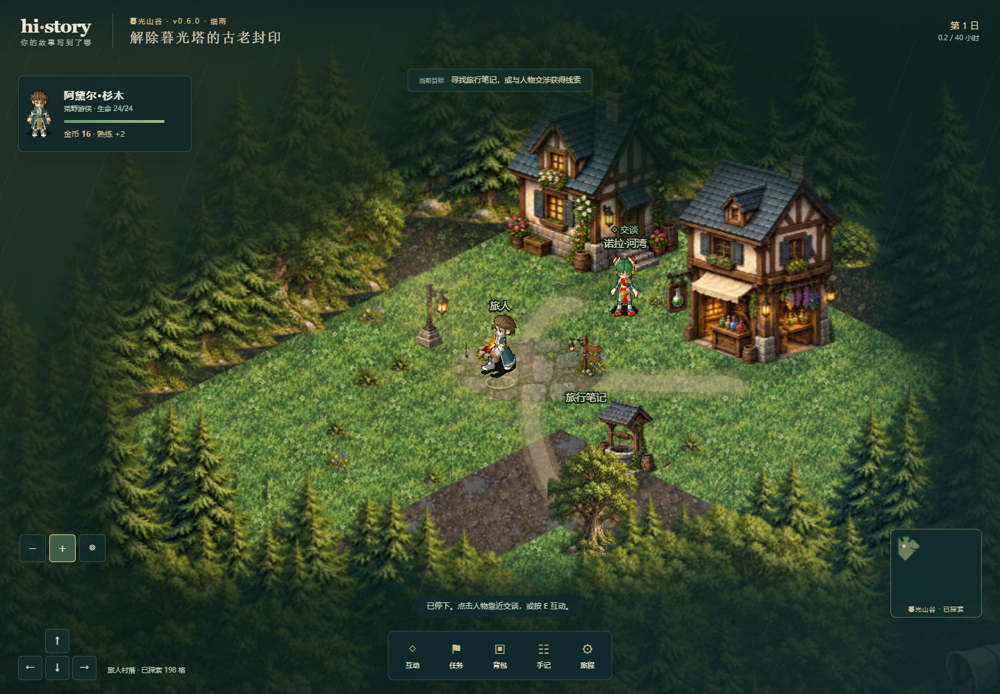
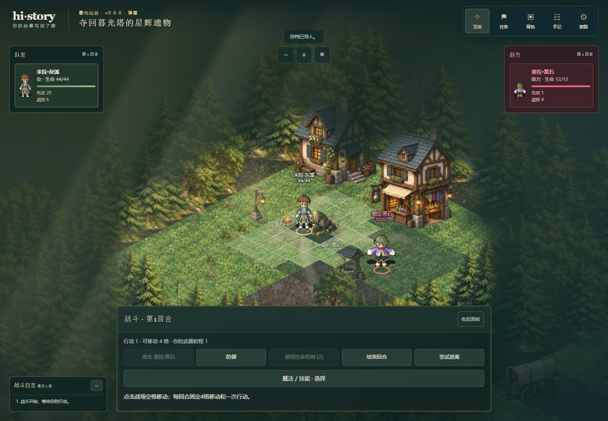
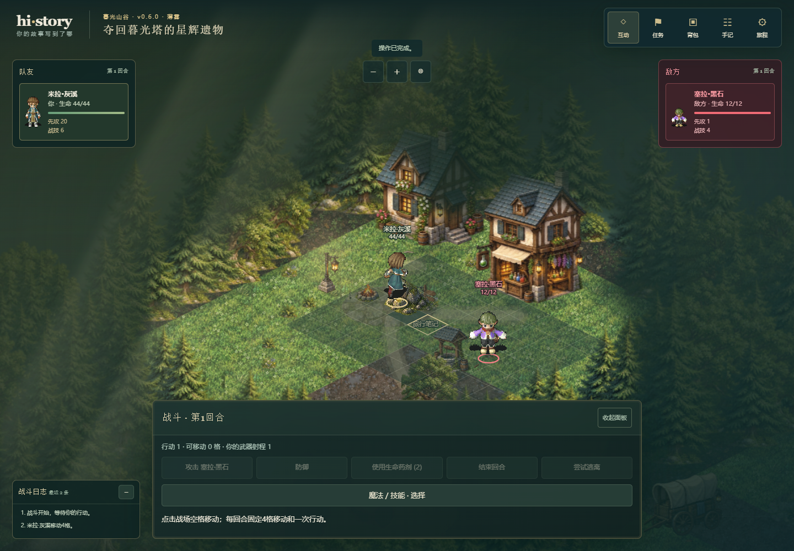
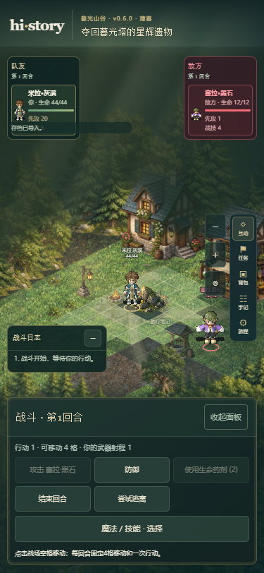

# 人物附加阴影修正验证

日期：2026-10-18。分支 `codex/fix-character-shadow`，继承已推送的 `codex/battle-side-dice@7a67f8a`。提交号以本报告所在Git提交为准。产品/快照0.6.0、schema5/demo-contract/5、save1及保存槽保持；线上仍v0.5.0，本轮未部署。

## 原因与修改

完整人物/怪物帧已经带有阴影，表现层另有两类叠加：WorldScene在所有人物脚下填充深色椭圆，SVG人物图像通过CSS套用drop-shadow（玩家另有一条投影规则）。这些层与原帧重叠，会加深脚下和身体轮廓。

- 移除Canvas额外的角色实心椭圆，以及旧SVG世界人物的同类椭圆。
- 移除共用SVG人物和玩家图像的CSS投影，战斗使用原素材帧。
- 保留原图集像素、透明度、帧时长、统一比例、脚底锚点及原有阴影。人物和怪物共用此规则。
- 保留玩家金色和敌方红色的描边定位/阵营圈，它们不是实心阴影；景物的阴影仍沿用。

没有修改原素材文件、模型选择、角色资料、HP/资源/骰子或移动规则。应用及领域接口不变；运行器仍唯一结算。

## 实际检查

Windows、Node24.16.0、Chrome；Playwright单worker，桌面1440×1000与窄屏375×812。

| 检查 | 结果 |
| --- | --- |
| 类型检查 | `npm.cmd run typecheck` 通过 |
| 模块边界 | `npm.cmd run check:boundaries` 通过 |
| 生产构建 | `npm.cmd run build` 通过，133模块 |
| 人物/战斗/镜头/慢设备 | 18/18通过，160.7秒；[原始结果](evidence/character-shadow-browser.json) |
| 怪物入场与施法 | 4/4通过，23.9秒；[原始结果](evidence/character-shadow-monsters-browser.json) |
| 差异检查 | CSS/旧SVG变化逐项核对仅移除指定阴影，`git diff --check` 通过；public素材没有改动 |

18项覆盖切换人物后的规则进度保持、探索行走与缩放居中、战术绕障跑步、敌方跑步、法术资源和日志、移动中刷新、退出战斗与慢设备停止响应。使用既有浏览器回归，无新增领域测试或与CSS实现重复的单测；未重跑无关的完整逻辑套件。

## 已核对画面

实际打开查看探索地图、战斗站立和跑步、怪物施法及375px画面。原帧阴影和描边圈仍可见，不再叠加角色椭圆或模糊投影。









另保留 [375px探索截图](evidence/character-shadow-world-narrow.png)、[怪物施法](evidence/character-shadow-monster-casting.png)及[375px怪物战斗](evidence/character-shadow-monster-narrow.png)。这些为本地生产预览，不代表公网已经更新。

## 复验命令

```powershell
npm.cmd run typecheck
npm.cmd run check:boundaries
npm.cmd run build
$env:CHROMIUM_PATH='C:\Program Files\Google\Chrome\Application\chrome.exe'
$env:PLAYWRIGHT_REPORT_PATH='docs/evidence/character-shadow-browser.json'
npm.cmd run test:e2e -- tests/e2e/external-character-game.spec.ts tests/e2e/player-camera.spec.ts tests/e2e/battle-layout.spec.ts tests/e2e/scene-responsiveness.spec.ts
$env:PLAYWRIGHT_REPORT_PATH='docs/evidence/character-shadow-monsters-browser.json'
node node_modules/@playwright/test/cli.js test tests/e2e/monster-effects.spec.ts --grep '哨塔真实唤醒|魔物施法使用图鉴'
```

怪物聚焦命令使用Node直接启动CLI，避免Windows npm脚本转交cmd时把正则的竖线解释为管道。此前一次npm命令在启动测试前因此被shell拒绝，没有产生测试结果；修正命令后才计入实际验证。
