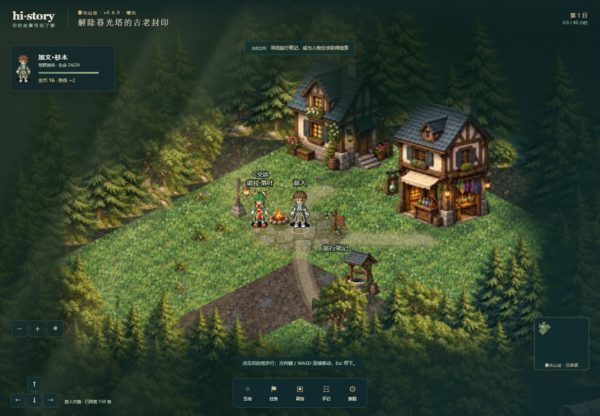

# 默认场景1.5倍验证

2026-10-18至19日本地验证。分支 `codex/default-scene-zoom`，继承74656ea；提交号以本报告所在Git提交为准。线上仍v0.5.0，本轮未部署。

探索初始化和进入战斗统一使用 `DEFAULT_SCENE_ZOOM=1.5`，桌面和窄屏一致。原先探索桌面1.25/窄屏1.45，战斗桌面1.15/窄屏0.7。保留手动缩放0.45至2.4、每次0.2及人物居中；离开战斗恢复进入前的探索缩放。只放大场景，不缩放HUD或改变素材/规则。产品0.6.0/schema5/save1及接口不变。

## 实际检查

Windows、Node24.16.0、Chrome，桌面1440×1000、窄屏375×812。

- typecheck、check:boundaries、build通过（133模块）。
- 既有浏览器回归6/6通过：人物外形切换与进度保持、移动/缩放/屏幕变化时居中、自动步行与战术移动、离开战斗恢复探索。结果见 [原始报告](evidence/default-scene-zoom-browser.json)。
- 另以真实浏览器分别核对两种尺寸：SVG视口实际缩放为1.5，点击＋变1.7，点击－回1.5，缩放前后的存档字符串相同。
- 已打开核对两种尺寸的初始1.5倍画面；人物中心与原素材阴影保持。未添加重复实现的单测，未重跑无关的完整逻辑套件。




## 复验

```powershell
npm.cmd run typecheck
npm.cmd run check:boundaries
npm.cmd run build
$env:CHROMIUM_PATH='C:\Program Files\Google\Chrome\Application\chrome.exe'
$env:PLAYWRIGHT_REPORT_PATH='docs/evidence/default-scene-zoom-browser.json'
npm.cmd run test:e2e -- tests/e2e/player-camera.spec.ts tests/e2e/external-character-game.spec.ts
```
