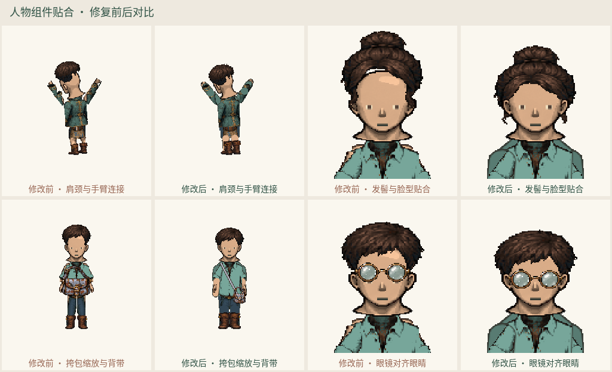

# 人物组件贴合自测报告

自测发现旧版存在可见的肩颈/手臂断缝、悬空发丝、头发与脸型间隙、挎包过大、眼镜偏高，以及部分高个角色静态导出截掉发型的问题。本次已直接修复，并重新导出动作图集与预览。当前渲染版本为 `character-motion-art/2`，人物生成参数、样式 ID 和旧种子结果未改变。

## 测试范围与结果

基线为已提交版本 `8d0a007`，两次使用相同人物参数和动作采样。

| 检查 | 基线 | 修复后 |
| --- | ---: | ---: |
| 动作采样帧 | 3584 | 3584 |
| 发型/身材/方向采样帧 | 1536 | 1536 |
| 动作用例的独立大块候选帧 | 642 | 0 |
| 发型用例的独立大块候选帧 | 64 | 0 |
| 静态导出截边 | 38 / 192 | 0 / 192 |
| 动作画布截边 | 0 | 0 |

独立大块按八邻域连通、面积至少 20 像素统计，测试人物不带独立首饰或武器，避免将合理的小饰品和特效误算为断肢。该指标用于发现断缝候选，不能直接等同于美术质量评分。另人工查看了 592 个视觉对照单元，覆盖男女身体、全部 8 种身材、12 发型×8 脸型、五个实际视角、全部上衣样式和 12 饰品选项；其中 288 个专门检查 12 下装×8 鞋型在正/侧/背面的裤脚与鞋帮衔接。动作自动检查覆盖八方向、全部 25 动作；行走采样 4 个相位。

类型检查、模块边界、构建通过；128 项单元测试与 28 项桌面/窄屏浏览器测试通过。81 张导出图集、2496 帧仍通过透明、非空、尺寸与边缘检查。

## 修复内容

| 部位 | 发现的问题 | 修复 |
| --- | --- | --- |
| 肩颈、肘、膝、手腕 | 抬手/施法/倒地时源图透明边缘无法相接 | 统一连接点与连续关节轮廓，纹理仍来自原始 PNG |
| 身材与衣裤 | 身材主要整体缩放，腰腿接缝和粗细不稳定 | 单独注册肩、腰、髋和四肢宽度；衣物共享这些尺寸；裤腰补齐连接 |
| 鞋与裤腿 | 单脚切片夹带相邻鞋的碎条；布鞋/凉鞋与长靴等高 | 分离单脚主轮廓，按鞋型设置鞋帮高度，并统一脚踝和鞋底位置 |
| 发型与脸 | 发际线空隙、遮挡五官、侧面悬空发丝 | 校准发型冠部，区分背发/刘海/侧面遮挡，保留五官窗口 |
| 饰品 | 眼镜高于眼睛、耳饰定位不随视角、挎包覆盖整个躯干 | 眼部和耳部锚点；背视角发带；挎包缩为髋部大小并连接背带 |
| 坐姿与静态输出 | 坐姿大腿投影不合理；高个/大体积外观被固定窗口裁掉 | 区分正侧坐姿与裙摆投影；静态画布按完整轮廓适配 |

额外修复了低帧率时预览计时被反复截短、导致骰子表情延迟过期的问题，并添加模拟慢帧的浏览器回归。图片导出尺寸及人物参数接口不变，旧版静态原图装配器保留。

## 视觉证据



- [男性身材与四方向](body-male.png)
- [女性身材与四方向](body-female.png)
- [衣物与抬手/坐姿](outfits.png)
- [全部发型×脸型](hair-face.png)
- [全部发型的五视角](hair-directions.png)
- [饰品正/侧/背视角](accessories.png)
- [12 下装×8 鞋型：正面](pants-shoes-S.png)
- [12 下装×8 鞋型：侧面](pants-shoes-E.png)
- [12 下装×8 鞋型：背面](pants-shoes-N.png)
- [机器检查摘要](summary.json)

## 复跑

```sh
CHROMIUM_PATH=/path/to/chromium npm run characters:audit
CHROMIUM_PATH=/path/to/chromium npm run characters:audit -- --compare yes
```

默认输出 `artifacts/character-fit-audit/`，包含完整逐帧记录和图片矩阵；对比模式需要 Git 中保留基线提交。检查失败时返回非零退出码。此检查是固定场景与组合采样，不是对全部样式、颜色、动作相位的笛卡尔积穷举。当前仍为分层骨骼原型，衣物褶皱与快速大幅扭转的透视表现仍能看出分段痕迹，尚未达到逐帧手绘成品的精度。
