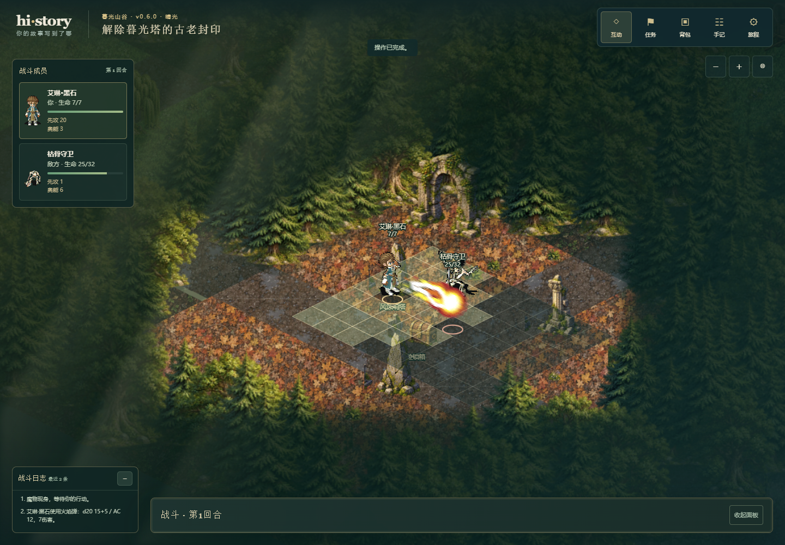
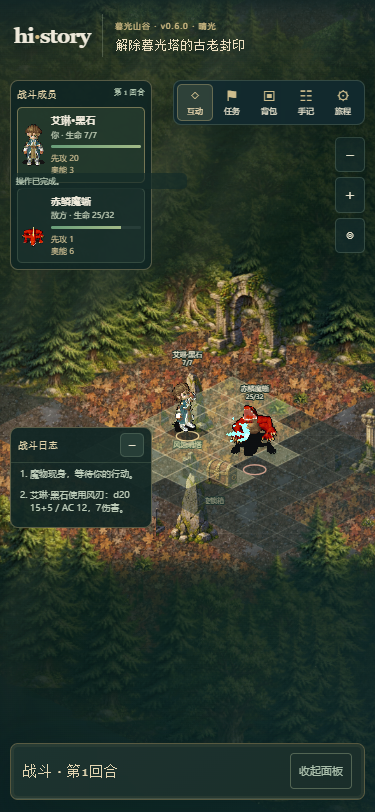
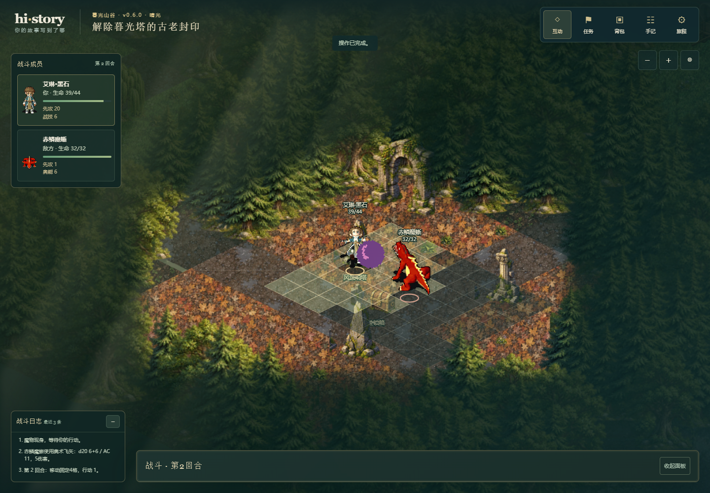

# 魔物与法术特效验证

日期：2026-10-18。分支 `codex/combat-monster-effects`，基于已推送eb6f196。产品/快照0.6.0、schema5/demo-contract/5、save1与world-v2保存槽保持。此为候选源码；线上仍v0.5.0，本轮没有部署网站。提交号以同报告的Git历史为准。

## 可复核成果

探索互动面板提供“风蚀哨塔·魔物踪迹”。通过真实行走靠近哨塔后，显现一次独立魔物，再走近挑战；击退不能重复显现，逃离保留原身份/生命。模型、地图、战斗、头像和刷新恢复一致；向导/医者/守卫等人物不替换。数值来自原运行器scholar或职业wizard规则，素材站数值不导入。

两只各8类八方向，共128组752帧，16张图集1,029,362字节；包含实际06魔法/03冲刺。五种特效火冰雷风奥术共35帧，两个原作者页标注CC0；治疗为项目SVG。共25个新资源文件1,138,198字节（包括JSON），均同源按需加载。来源、许可证、导入工具与范围详见 [接入说明](../怪物与战斗特效接入说明.md)，机器核验 [怪物清单](../public/assets/monsters/molibaike/verification.json) 和 [特效清单](../public/assets/effects/spells/manifest.json)。

应用 `combat-effects/1` 校验同局成功回执指纹、新骰子及已执行技能，实际命中/未命中/豁免成功/治疗分别表现。播放顺序为实际移动→效果→原骰子，输入仍锁定；施法期间临时收起底部内容。击倒目标的最后一发保留原战场完成效果，之后再切战后界面。失败素材请求跳过效果继续流程，中途刷新恢复已提交状态，不重播或再消费。核心HP、资源、行动和RNG计算不修改。

## 实际验证

Windows、Node24.16.0、Chrome，Playwright单worker、1440×1000和375×812。

| 检查 | 实际结果 |
| --- | --- |
| 类型/模块边界 | typecheck、check:boundaries通过 |
| 构建 | build通过，133模块 |
| GIF与PNG离线逐像素 | 128组752怪物帧及35特效帧全部通过，保留原GIF时长；PNG明示项目90ms/帧 |
| 完整逻辑 | 28文件403/403通过，约227.8秒；[原始结果](evidence/monster-effects-logic.json) |
| 增补治疗后聚焦逻辑 | 2文件12/12通过；[原始结果](evidence/monster-effects-focused-logic.json)。与完整逻辑有11项重叠，合计404项不同用例分批通过，不是一次404项全量运行 |
| 最终浏览器 | 54/54一次通过，340.5秒，开始于2026-10-18 23:06:10（北京时间），零跳过/失败/重试；[原始结果](evidence/monster-effects-browser.json) |

新增逻辑覆盖：魔物目录无战斗数值、普通NPC不变、远处/未知/战斗中拒绝、查询只读、显现唯一性/去重、失败回滚、同一模型/数值保存恢复、坏身份存档拒绝、四系投影与命令指纹、未命中/豁免/最后一击、真实治疗、128组动作及图集哈希/边界和35帧CC0来源。

新增16项桌面/窄屏浏览器用例通过真实导入入口设置合法场景：哨塔实际显现/靠近/开战、模型/头像/普通人物/刷新；四种元素各自实际出现、一次资源消费与恢复；魔物真实06施法；减少动态效果下的治疗和中途刷新；终结一击和失败特效请求不锁死战斗。额外回归覆盖战斗跑步与布局、技能目标与资源、人物素材馆全部动作/八向/旧入口/失败重试、人物选择、镜头和慢设备响应。未执行仓库所有历史浏览器用例，不以此替代公网发布检查。

## 修正与边界

- 初期逻辑测试夹具错误改写职业maxHp、又未在哨塔位置更新可见范围，触发已有职业派生/距离拒绝。改为合法派生角色与公开revealRuntime，保留拒绝校验，最终聚焦通过。
- 前三次浏览器尝试各2通过/12失败，失败在测试夹具升级调用：先误读返回结构，之后漏选3级专精和4级属性。修正夹具以公开升级入口构造合法角色，不修改游戏升级或存档校验。
- 第四次12通过/2失败：暂停浏览器时钟下，特效出现后尚未推进100ms人物绘制，图像仍为重绘占位；补充等待真实绘制的检查，随后施法/治疗专项2/2通过。
- 实际截图复核发现展开的技能区遮住弹道，表现层增加播放期间临时收起，之后恢复；未绕过目标选择、输入锁或force点击。所有失败JSON/trace保留本地忽略目录 `_handoff/audit/monster-effects-*`。
- 跑步花妖页面没有动画ID，未猜测或报告导入；改用可验证的火龙蜥。怪物版权与CC0特效分开记录，未将全站素材当作已授权或已下载。

尚无全图鉴、怪物成长/掉落、元素抗性、持续/范围状态、伙伴回合、完整逐攻击延迟揭晓或战斗入场过场。旧版源码不了解monsterId，只能用通用人物替代显示；当前候选支持恢复旧人物/职业存档。新可选身份经校验保存，不引入第二套HP/RNG或动画持久队列。

## 视觉证据

最终54项包括16项新怪物/特效与38项回归。已实际打开核对桌面火焰弹、图鉴06施法和375px风刃截图，确认施法时底部内容临时收起，头像、日志、魔物与效果出现在真实战场；均为本地生产预览截图。







## 复验

```powershell
npm.cmd run typecheck
npm.cmd run check:boundaries
npm.cmd test -- --reporter=json --outputFile=docs/evidence/monster-effects-logic.json
npm.cmd run build
$env:CHROMIUM_PATH='C:\Program Files\Google\Chrome\Application\chrome.exe'
$env:PLAYWRIGHT_REPORT_PATH='docs/evidence/monster-effects-browser.json'
npm.cmd run test:e2e -- tests/e2e/monster-effects.spec.ts tests/e2e/battle-layout.spec.ts tests/e2e/combat-skills.spec.ts tests/e2e/external-character-game.spec.ts tests/e2e/character-library.spec.ts tests/e2e/player-camera.spec.ts tests/e2e/scene-responsiveness.spec.ts
```

离线素材核验需使用带Pillow的Python执行 `tooling/import-combat-assets.py --offline`，并保留本地 `_handoff/combat-assets-source` 缓存；公开仓库不包含原始缓存。源码上传不等于网站发布，本轮没有修改gh-pages。
