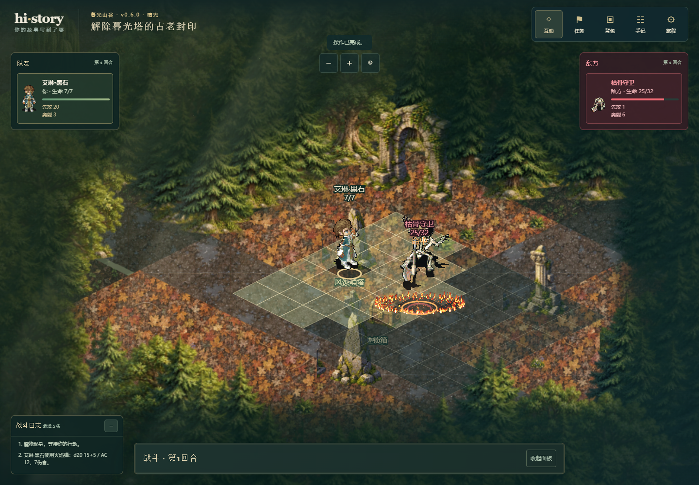
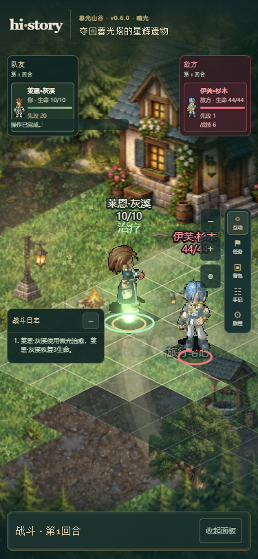

# PixelFX 战斗特效接入验证

后续 `codex/adventure-asset-preload` 已将本页所述按需加载扩展为开局准备六类图集；战斗补载的2500ms预算保持。该增量验证见 [开局素材准备](asset-preload-validation.md)，本页保留原PixelFX接入阶段的测量与验证记录。

2026-11-17，分支 `codex/pixelfx-combat-integration`，基于素材登记提交 `1d44040`。用户要求实际接入素材。本轮沿用产品0.6.0、`combat-effects/1`、schema5/save1；未部署线上，发布版本仍以 `docs/gameplay-closure-publication.md` 为准。

## 交付范围

固定来源 `patch-gg/pixelfx@5294518ce7c72e48b6100a744596e0acf57f2826`，按需导入火环、冰晶爆裂、雷击、旋风、奥术爆发、治疗光环。替换当前六类反馈，不增加技能或战斗数值，不导入244项全部目录、示例人物或图库字体。地面环形只是已有单目标技能的视觉效果，不代表范围伤害。

公开产物位于 `public/assets/effects/pixelfx/`，包含六张无损WebP、版本化manifest、逐帧核验、源文件哈希与MIT/NOTICE。原始源代码和RGBA中间帧存于忽略目录 `_handoff/`。依赖是离线导出所用Node与Pillow，不进入浏览器运行依赖。

## 实际表现

界面入口保持“旅程→职业规则→生成新旅程”，战斗中选择“魔法/技能”、合法目标并确认。已有火/冰/雷/风/奥术法术及治疗触发对应图集，敌方施法沿用奥术反馈。选择本身不提交；HP、资源、行动和RNG在播放前已经提交，播放只读取结果。

图集保留原尺寸、透明度、帧序列和时长，地面效果按脚底定位，雷击按身体定位。播放窗口为 `min(原图集总时长,1200ms)`，在窗口内按比例走完原序列，不循环；最后100ms淡出。减少动态模式使用经像素核验的非空预览帧，静止220ms。未命中按精灵宽度移到目标侧方，目标仍显示虚线与“未命中”；成功豁免半透明、虚线与“豁免成功”。

加载及解码共享2500ms预算，错误、损坏图集和超时均跳过特效并继续骰子结果；后台、换局、卸载可中断等待。保存仍记录已提交状态，不存动画队列。刷新不重放特效或重复消耗。

## 素材审计

使用 Game Studios 的 asset-audit 流程，按本项目WebP图集与manifest惯例检查。输入FOUND：固定来源及许可证、导出脚本、六类产物、代码引用、逐帧验证；没有缺失引用或未使用的新增图集，不借用Godot的命名或纹理规则。

实际导入446帧，六图集2,933,770字节（约2.80MiB），RGBA解码合计51,197,440字节（约48.8MiB），每项约1.85–13.78MiB。游戏只加载本次效果对应图集，成功缓存上限六类。逐帧像素/alpha无损往返、32个固定源文件的Git blob与SHA-256、最终产物哈希与manifest均已核对。

未建立全项目素材体积/帧预算，预算合规性为“未评估”，本次审计整体判定为“NOT ASSESSED：缺少预算标准”；已测量项目与未评估预算分开记录，不报告整体性能达标。

## 验证记录

已完成：

- 离线重新导出 `--offline --verify` 通过，逐帧RGBA、透明度及发布产物字节一致；7项专门素材用例通过。
- `npm test -- --maxWorkers=2`：34文件、444项逻辑测试通过，耗时270.96秒。另一次6文件60项受影响逻辑聚焦检查通过，这60项已包含在444项中，不重复累计。
- `npm run test:closure`：3文件18项通过，亦包含在444项内。
- 类型、模块边界、生产构建通过。
- 特效浏览器34项（桌面17、375px窄屏17）最终批次通过，覆盖六类真实播放、选择不结算、命中/未命中/豁免、治疗、终结一击、错误/超时、加载/播放取消和刷新恢复；[机器报告](evidence/pixelfx-browser-results.json)。
- 治疗截图采样调整后，桌面/窄屏2项单独复验通过；仍属于上述34项，不作为新增用例累计。[采样复验](evidence/pixelfx-healing-browser-results.json)。
- `npm run test:e2e:closure`：12项桌面/窄屏闭环通过，涵盖靠近人物、材料不足与补货、不可逆分支、先行动后接取、失败补救、截止时间以及保存恢复。[机器报告](evidence/pixelfx-closure-browser-results.json)。
- 原有战斗布局/技能浏览器18项通过，涵盖玩家/敌方跑步、绕障、面板、技能与目标选择、资源不足、真实行走开战及刷新恢复；[机器报告](evidence/pixelfx-combat-regression-results.json)。

共64项不同桌面/375px浏览器用例分三个最终批次通过，另有2项截图采样复验；不是一次全量全绿，也未运行仓库全部历史浏览器套件。源码、素材、测试与本报告一并提交于当前候选分支，实际提交哈希以Git历史为准。

首次问题与处理：

- 源码raw下载遇TLS EOF，改用GitHub连接器读取相同固定版本文本，仍核对锁定Git blob及SHA-256，没有降低TLS校验。
- 首次默认全量逻辑运行未产出结果时被中断，不能记为失败或通过。后续限制两工作进程完成444项；不把较长运行时间归因于产品缺陷。
- 浏览器首次未进入业务步骤：沙箱禁止loopback访问；允许本地测试通信后又发现Playwright内置headless shell缺失。使用已安装系统Chrome的headless模式完成后续运行，没有打开用户桌面窗口。
- 浏览器首次业务批的四项断言失败：误认为`wizard-3`需扣1资源（目录定义cost=0），以及误比较恢复前后整份快照（既有恢复机制会重建runId、清除命令回执）。修正为检查技能实际成本、HP/行动/RNG及恢复后的领域事实；不改变游戏规则来迎合测试。
- 初次窄屏静态治疗截图在人物施法图集尚未解码时采样，出现加载占位。调整测试为少量虚拟时间推进配合实际图像就绪等待，保留同一静态特效帧，两个尺寸复验和截图检查通过；这是采样时机修正，未修改人物加载逻辑。
- 代码复核发现固定距离的未命中偏移可能覆盖宽体怪物；最终按当前目标图像边界和特效宽度计算侧方间隔，浏览器检查实际屏幕几何。
- 提交前发现Windows的autocrlf会转换已锁定的许可/JSON字节，影响后续checkout的哈希与离线复验。新增仅覆盖PixelFX产物的`.gitattributes`（文本LF、WebP二进制），并核对启用autocrlf后的Git取出字节仍与实际产物一致。

## 复验入口

```powershell
python tooling/import-pixelfx.py --download-only
python tooling/import-pixelfx.py --offline --verify
npm test -- --maxWorkers=2
npm run test:closure
npm run typecheck
npm run check:boundaries
npm run build
$env:CHROMIUM_PATH='C:/Program Files/Google/Chrome/Application/chrome.exe'
$env:PLAYWRIGHT_REPORT_PATH='docs/evidence/pixelfx-browser-results.json'
npm run test:e2e -- tests/e2e/monster-effects.spec.ts tests/e2e/pixelfx-effects.spec.ts
$env:PLAYWRIGHT_REPORT_PATH='docs/evidence/pixelfx-closure-browser-results.json'
npm run test:e2e:closure
$env:PLAYWRIGHT_REPORT_PATH='docs/evidence/pixelfx-combat-regression-results.json'
npm run test:e2e -- tests/e2e/battle-layout.spec.ts tests/e2e/combat-skills.spec.ts
```

离线核验需要完整的固定版本源码缓存与Pillow 12.0.0。浏览器用例在headless模式运行，不操作用户桌面窗口。隐藏事件用例是显式 `document.hidden` 事件路径模拟，不能替代操作系统实际后台测试。公网新资源、真实慢网/低端设备帧率与全项目历史浏览器用例不属于本轮已验证范围。

## 实机视觉证据

已查看桌面火环及未命中避让、窄屏治疗与未命中截图；保留两张代表性截图：




